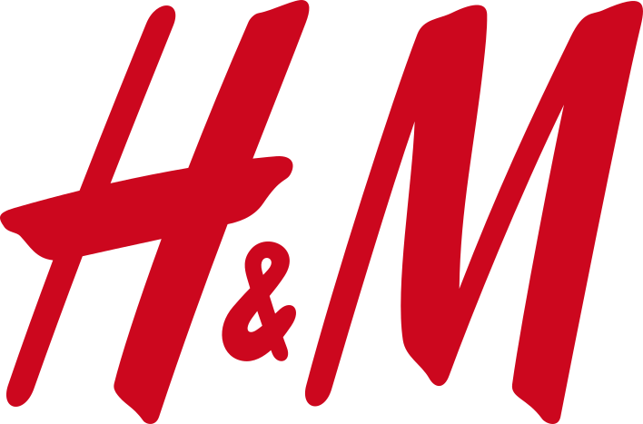

<!-- H&M 로고 출처: https://commons.wikimedia.org/wiki/File:H%26M-Logo.svg -->
<p align="center">
  
</p>

<h1 align="center">H&amp;M 구매 패턴과 RFM 고객 세분화</h1>

<p align="center">
  
  
  
  
  
  
</p>

H&M의 고객, 상품, 거래, 상품 이미지 데이터를 연결해 구매 패턴을 분석하고 RFM으로 고객을 분류한다. [분석 노트북](notebooks/analysis_report.ipynb)은 결측치 처리, IQR 이상치 탐지, 텍스트·이미지 피처, 통계 분석, 여섯 유형의 시각화를 포함한다. 전처리와 집계는 [DataAnalyzer](src/pipeline.py)에 구현했다.

## 데이터와 분석 범위

출처는 [H&M Personalized Fashion Recommendations](https://www.kaggle.com/competitions/h-and-m-personalized-fashion-recommendations/data)다. 거래 CSV의 고객 ID를 정렬해 시드 42로 100명을 뽑고, 선택된 고객의 전체 관측 기간 거래를 유지했다. Kaggle 실행 결과는 고객 100명, 거래 2,606행, 상품 2,152개다.

| 입력 | 사용한 정보 |
| --- | --- |
| `transactions_train.csv` | 거래일, 고객·상품 ID, 정규화 가격, 판매 채널 |
| `customers.csv` | 고객 ID, 멤버십 상태, 나이 |
| `articles.csv` | 상품 ID, 상품명, 상품 유형 |
| `images/` | 상품 사진의 평균 픽셀값과 표준편차 |

RFM 기준일은 표본의 마지막 거래일인 **2020-09-21**이다. Recency는 마지막 구매 후 지난 일수, Frequency는 서로 다른 구매 날짜 수, Monetary는 정규화 가격 합계다. Monetary는 표본 안에서 구매 규모를 비교하는 데 사용한다.

## 분석 결과

| 세그먼트 | 고객 수 | 평균 구매일 수 | 정규화 구매금액 비중 |
| --- | ---: | ---: | ---: |
| VIP | 24명 | 18.38 | 72.12% |
| Loyal | 8명 | 11.25 | 9.89% |
| Regular | 25명 | 2.16 | 5.49% |
| At Risk | 40명 | 2.13 | 12.08% |
| New | 3명 | 1.00 | 0.42% |

IQR 기준을 벗어난 가격은 167행(6.41%)이었다. 가격 분포 비교에 이상치 표시를 사용하고 RFM에는 전체 거래를 사용했다. 이미지가 없는 거래 4행을 제외한 가격과 이미지 평균의 피어슨 상관계수는 −0.1277, 가격과 이미지 표준편차는 0.1204였다. 두 상관계수 모두 0에 가까워 이 표본에서는 이미지 통계만으로 가격 차이를 설명하기 어렵다.

## 비즈니스 인사이트

1. **VIP 고객 유지.** VIP 24명이 정규화 구매금액 합계의 72.12%를 차지했다. VIP 고객에게 선호 상품군의 신상품이나 재입고를 안내해 재구매를 유도한다. VIP 내 대조군을 두고 동일 기간의 재구매율과 고객당 구매금액을 비교한다.
2. **At Risk 고객 중 재활성화 대상 선별.** At Risk 40명의 마지막 구매는 평균 505.45일 전이었다. 과거 구매금액과 평소 구매 간격을 함께 보고 연락할 고객을 좁혀 재구매를 유도한다. 구매 주기와 연락 수신 동의 정보를 확인하고, 선별된 고객의 후속 구매율을 대조군과 비교한다.
3. **Loyal과 Regular의 다음 구매 유도.** 평균 구매일 수는 Loyal 11.25일, Regular 2.16일이었다. Loyal에는 반복 구매한 상품군의 후속 상품을, Regular에는 관심 상품과 함께 구매할 만한 상품을 안내해 구매일 수 증가를 목표로 한다. 세그먼트마다 대조군을 두고 후속 구매일 수를 비교한다.

## 로컬 실행

1. Kaggle에서 [대회 규칙](https://www.kaggle.com/competitions/h-and-m-personalized-fashion-recommendations/rules)을 확인하고 CSV 세 개와 상품 이미지를 내려받는다.
2. 저장소 루트의 `data/` 아래에 CSV 세 개와 `images/`를 둔다. 이미지의 원래 하위 폴더 구조를 유지한다. 다른 위치에 두었다면 Jupyter를 실행하기 전에 `HM_DATA_DIR` 환경변수에 데이터 디렉터리를 지정한다.
3. Python 3.11 환경에서 아래 명령으로 Jupyter를 열고, `notebooks/analysis_report.ipynb`의 셀을 위에서부터 실행한다.

```bash
python3.11 -m venv .venv
source .venv/bin/activate
python -m pip install -r requirements.txt notebook
python -m jupyter notebook
```

거래 CSV는 고객 ID 수집과 거래 추출을 위해 청크 단위로 두 번 읽는다. 노트북에 저장된 표와 차트는 [Kaggle에서 실행한 분석](https://www.kaggle.com/code/imjongseok/h-m-customer-sample-preparation)의 집계 결과다.
